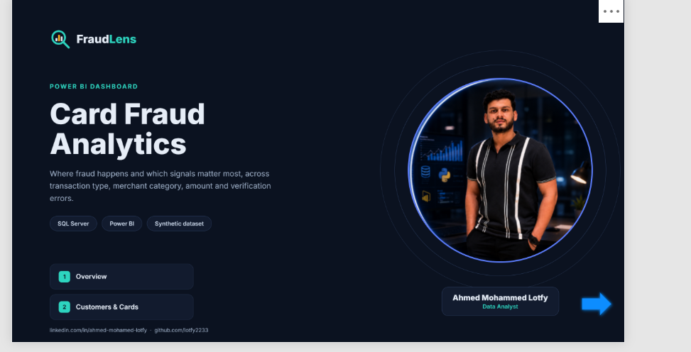

# FraudLens Risk Radar
An explainable transaction-risk engine: **SQL Server → Power BI**. Every flagged transaction shows *why* it was flagged.

**Data:** 434,252 synthetic card transactions (Jan 1 – May 11, 2010), 6,146 cards, 2,000 clients. Three source tables (transactions, cards, users) were merged into one table in SQL Server.

## How it works
Each transaction gets a 0–100 risk score from six signals, then a tier (High ≥ 45, Medium ≥ 20):

| Signal | Points |
|---|---|
| Impossible travel (different state ≤ 60 min after previous transaction) | 40 |
| Card error (Bad PIN, CVV, balance…) | 25 |
| Amount spike (> 3σ above the client's own average) | 20 |
| Card found on dark web | 15 |
| Online transaction | 10 |
| Night time (00:00–04:59) | 10 |

## Result
- 336 transactions (0.08%) land in High risk, about $106K exposed.
- 2,506 impossible-travel hits.
- Online transactions are flagged 11.0% of the time vs 3.1% for in-person swipes.
- No card in this sample is on the dark web, so that signal fires 0 times.

## Limits (read before you quote numbers)
- The files have **no fraud label**, so this is a risk score, not confirmed fraud. Weights are hand-set; validate them against labels before any real use.
- Only part 1 of the transactions file is loaded, so May 2010 is a partial month.

## Files
| File | What it does |
|---|---|
| `01_FraudLens_RiskRadar.sql` | First version of the risk engine on the raw tables |
| `02_Load_and_Questions.sql` | Load script and analysis questions |
| `03_Final_Fix_and_Questions.sql` | Final clean view `vw_master` and questions |
| `04_PowerBI_Measures.dax.txt` | Power BI measures |
| `05_Dashboard_Views.sql` | 12 views, one per dashboard visual |
| `dashboard.html` | Interactive web preview (download and open in a browser) |

## Run it
1. Load the merged table into SQL Server as `dbo.fraudlens_master`.
2. Run `03_Final_Fix_and_Questions.sql` (creates `vw_master`).
3. Run `05_Dashboard_Views.sql` (creates the 12 views).
4. Power BI: Get Data → SQL Server → select the `vw_q01` … `vw_q12` views.

The merged CSV (about 100 MB) is not included because of GitHub's file size limit.

Author: Ahmed Mohammed Lotfy · [LinkedIn](https://www.linkedin.com/in/ahmed-mohamed-lotfy/)
